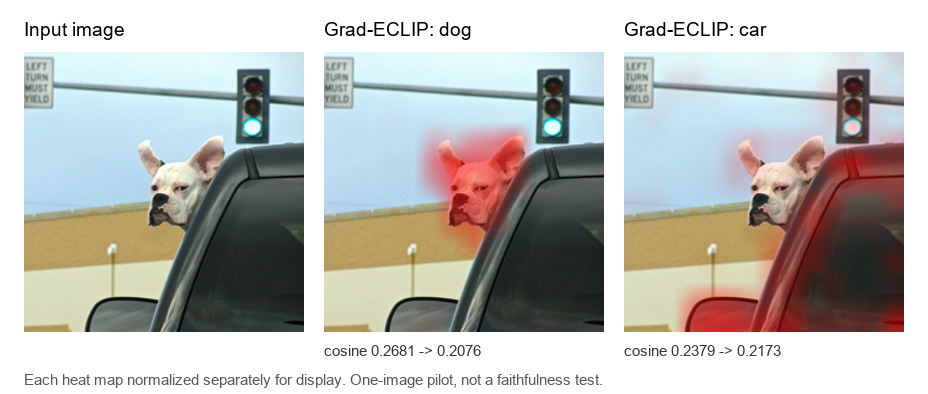

# Grad-ECLIP minimal visual baseline

A small, reproducible pilot using the [authors' Grad-ECLIP repository](https://github.com/Cyang-Zhao/Grad-Eclip) and [OpenAI CLIP](https://github.com/openai/CLIP). It generates visual explanations for the official `dog_and_car.png` example with the prompts `dog` and `car`, and compares original multi-head CLIP scores with the single-head forward used for visualization.



**Status:** One-image pilot completed on 3 November 2026. This is not a reproduction of the paper's dataset-level results or a faithfulness evaluation. Each displayed heat map is normalized separately, so color intensity cannot be compared across prompts.

## Observed scores

| Prompt | Original CLIP cosine | 12-head control cosine | Single-head cosine | Single − original |
| --- | ---: | ---: | ---: | ---: |
| dog | 0.26811314 | 0.26811311 | 0.20764273 | −0.06047040 |
| car | 0.23793063 | 0.23793063 | 0.21726526 | −0.02066536 |

The 12-head control follows the same extracted forward code and matches original CLIP within 3×10⁻⁸. The score changes in the single-head run are therefore attributable to the head setting in this pilot's code path. This result alone does not establish explanation faithfulness.

## Reproduce on Windows CPU

Tested with Python 3.14.6 and Git on Windows. Run in PowerShell from the repository root:

```powershell
.\setup_windows.ps1
& .\.venv\Scripts\python.exe .\scripts\run_baseline.py
& .\.venv\Scripts\python.exe .\scripts\make_comparison.py
```

The setup script clones and checks out these exact upstream commits into ignored `external/`:

- Grad-ECLIP: `e370e6cb194faf2020f5d1ed268f9d57e91a38e6`
- OpenAI CLIP: `d05afc436d78f1c48dc0dbf8e5980a9d471f35f6`

The first run downloads CLIP ViT-B/16 weights into ignored `models/`. The checkpoint used for the recorded results has SHA256 `5806e77cd80f8b59890b7e101eabd078d9fb84e6937f9e85e4ecb61988df416f`.

## What the script does

`scripts/run_baseline.py` reads the official `grad_eclip_image.ipynb` functions (cells 4 and 9). It changes the notebook's forced `x.half()` to the loaded model's dtype to run on CPU. It uses standard CLIP 224×224 preprocessing, the last visual Transformer block (`n=1`), and a 14×14 patch map. The red overlays are custom rendering; raw maps are saved as `.npy`.

The official notebook's full-resolution image path, four-prompt figure, other XAI baselines, and paper-reported quantitative metrics were not run. See [the paper's methodology](https://arxiv.org/html/2502.18816) for the original formulation.

## Files

- `scripts/`: baseline runner and comparison figure generator.
- `results/2026-11-03/results.json`: scores, versions, commits, and image hash.
- `results/2026-11-03/*_heatmap_raw.npy`: numeric 14×14 maps.
- `results/2026-11-03/*.png`: overlays and comparison figure.

Next step: define and run a small faithfulness test against the original multi-head CLIP score, including an explicit image-perturbation protocol.
